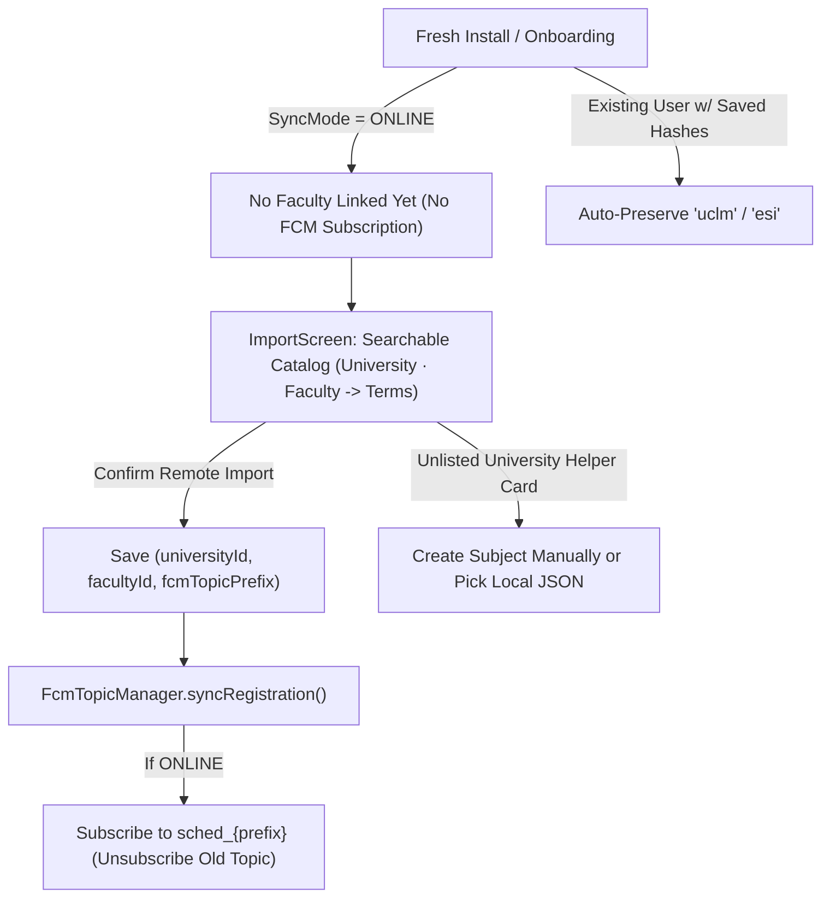

# Implementation Plan: Multi-Faculty Catalog Import & On-Import FCM Topic Binding

> [!IMPORTANT]
> Onboarding remains unchanged. University & Faculty selection happens implicitly when the user imports a remote schedule from the searchable 3-level catalog in `ImportScreen`, which binds the faculty and subscribes to its FCM topic when `SyncMode.ONLINE` is active.

## Architecture & Flow

---

## 1. Faculty State & FCM Topic Lifecycle

### `app/src/main/java/com/marcoslorcar/clementime/data/SettingsRepository.kt`
- **Unset Default on Fresh Install with Legacy Migration Fallback**:
  - Instead of unconditionally returning `"uclm"` / `"esi"` when `selected_university_id` / `selected_faculty_id` are absent in DataStore, check if legacy remote hashes exist (`last_known_schedule_hash_1` or `last_known_schedule_hash_2` is non-empty) via pure testable `resolveSelectedUniversityId(...)` and `resolveSelectedFacultyId(...)` helpers.
  - If legacy hashes exist, fall back to `"uclm"` / `"esi"` so existing ESI users remain linked without interruption.
  - Otherwise, emit `""` (empty string) on fresh installs until the user imports a remote schedule.
- **Persist Faculty Display Metadata & Topic Prefix**:
  - Extend `setSelectedFaculty(universityId: String, facultyId: String, universityName: String? = null, facultyName: String? = null, fcmTopicPrefix: String? = null)` and expose `selectedUniversityNameFlow`, `selectedFacultyNameFlow`, and `selectedFcmTopicPrefixFlow` so `MoreScreen` and `FcmTopicManager` know the human-readable label and custom `fcm_topic_prefix` without needing a network call.

### `app/src/main/java/com/marcoslorcar/clementime/worker/FcmTopicManager.kt`
- **Top-Level Unlinked Guard**:
  - At the very top of `syncRegistration(context, settingsRepository)`, if `syncMode == SyncMode.OFFLINE || universityId.isBlank() || facultyId.isBlank()`, unsubscribe from any stale `previousTopic` (when GMS is available), clear `subscribedFcmTopic` (`""`), cancel periodic work, and return immediately without subscribing.
- **Sanitized `fcm_topic_prefix` Resolution**:
  - In `topicFor(universityId, facultyId, fcmTopicPrefix = null)`, sanitize `fcmTopicPrefix` (trim, strip optional `sched_` prefix, lowercase, replace non-`[a-z0-9_-]` with `_`) and return `"sched_$customPrefix"` when non-blank, falling back to `"sched_${uni}_${fac}"`.

---

## 2. Full Catalog Browsing, Caching & Binding on Import

### `app/src/main/java/com/marcoslorcar/clementime/data/importing/repository/ImportRepository.kt`
- **Strict `(universityId, facultyId)` Matching**:
  - Update `fetchRemoteSchedules(rawBaseUrl, facultyId, cacheBust, universityId)` to match `(universityId, facultyId)` strictly in `schedules_catalog.json` with **no** fallback to `catalog.universities.firstOrNull()?.faculties?.firstOrNull()`. Only fall back to `schedules_index.json` when `schedules_catalog.json` fails to fetch/parse and `facultyId` matches `"esi"`.
- **Full Catalog Loading**:
  - Use `fetchRemoteCatalog(rawBaseUrl, cacheBust)` (with fallback to `schedules_index.json` wrapped into a synthetic `UCLM · ESI` `ScheduleCatalog` if needed) to return all universities, faculties, and terms.
- **Scoped Cache Keys & Faculty Parameters**:
  - Extend `CacheMetadata` with optional faculty metadata fields (`universityId`, `universityName`, `facultyId`, `facultyName`, `fcmTopicPrefix`, `termId` all defaulting to `null`).
  - Scope remote cache filenames and `CacheMetadata` IDs by `"${universityId}_${facultyId}_${termId}"` while preserving fallback reads from legacy `"cache_${semester}C.json"` in `getCachedRemoteSlotsForSemester(context, semester, universityId, facultyId)` and passing `universityId`/`facultyId` through `applySlotDiffs(...)`.

### `app/src/main/java/com/marcoslorcar/clementime/ui/screens/scheduleimport/ImportViewModel.kt`
- **Attach Faculty Metadata to `ImportFile`**:
  - Extend `ImportFile` with `universityId: String? = null`, `universityName: String? = null`, `facultyId: String? = null`, `facultyName: String? = null`, `fcmTopicPrefix: String? = null`, and `termId: String? = null`, using scoped `id = "${universityId}_${facultyId}_${term.id}"`.
  - In `loadLibrary(context)`, load the full catalog via `repository.fetchRemoteCatalog(baseUrl)` and sort faculty groups so the user's currently linked `(universityId, facultyId)` is pinned to the top.
- **Bind Faculty, Reset Hashes on Switch & Trigger FCM on `confirmImport()`**:
  - When `selectedFile.sourceType == ImportSourceType.REMOTE` and `facultyId != null`:
    - If switching to a different `(universityId, facultyId)`, call `settingsRepository.resetScheduleHashes()` so stale hashes from the previous faculty do not suppress or pollute future diff checks.
    - Call `settingsRepository.setSelectedFaculty(...)` with the imported file's university/faculty IDs, names, and `fcmTopicPrefix`.
    - Call `FcmTopicManager.syncRegistration(context, settingsRepository)` when `context != null` so `ONLINE` users subscribe immediately to the imported faculty's topic.

### `app/src/main/java/com/marcoslorcar/clementime/ui/screens/scheduleimport/ImportScreen.kt`, `ImportComponents.kt` & `MainActivity.kt`
- **Navigation Wiring**:
  - Wire `onNavigateToAddSubject` from `MainActivity` -> `ImportScreen` -> `ImportComponents` (`ImportLibraryContent`).
- **Grouped University · Faculty Sections**:
  - Render remote `ImportFile` items grouped under a section header for each `University · Faculty` (with a badge/indicator if it is the currently linked faculty).
  - Update the search filter in `ImportLibraryContent` to match against `universityName`, `universityId`, `facultyName`, `facultyId`, `title`, and `description`.
- **"Unlisted University?" Helper Card**:
  - Render a helper card at the bottom of the remote catalog list, when a search query matches no remote schedules, and in the empty state when no remote schedules are loaded, offering direct buttons to **Create Subject** (navigating via `onNavigateToAddSubject` to `AddEditSubjectRoute()`) or **Select Local JSON File** (launching the JSON document picker).

---

## 3. Worker, Settings UI & Faculty-Neutral Strings

### `app/src/main/java/com/marcoslorcar/clementime/worker/ScheduleUpdateWorker.kt`
- Read both `selectedUniversityIdFlow` and `selectedFacultyIdFlow`.
- If `facultyId.isBlank()`, exit cleanly (`Result.success()`) without polling remote schedules.
- Pass both `universityId` and `facultyId` into `importRepository.fetchRemoteSchedules(...)`.

### `app/src/main/java/com/marcoslorcar/clementime/ui/screens/settings/MoreViewModel.kt` & `MoreScreen.kt`
- Keep `@ApplicationContext private val context: Context? = null` nullable and wrap `AppCompatDelegate.getApplicationLocales()` in `runCatching` to preserve plain JVM unit-test compatibility.
- Expose `selectedUniversityId`, `selectedFacultyId`, and the human-readable linked faculty label in `MoreUiState`.
- In `MoreViewModel.debugShowFcmStatus`, guard against unlinked faculty (do not report a bogus target topic when `universityId` or `facultyId` is blank).
- In `MoreScreen`'s Sync section, show the **Linked Faculty** row (e.g. `UCLM · Escuela Superior de Informática (ESI)` or `No faculty linked yet — import an online schedule`).
- Disable or guard **Check for updates now** when no faculty is linked yet (showing a snackbar/toast prompting the user to import a remote schedule first).

### `app/src/main/res/values/strings.xml` & `app/src/main/res/values-es/strings.xml`
- Update `schedule_changes_detected_desc` (EN & ES) and `onboarding_autoupdate_desc` (ES) to remove hardcoded `"ESI"` phrasing.
- Add localized EN/ES strings for the grouped catalog headers, "Unlisted university?" helper card, and Settings linked-faculty status row.
- Keep existing localized `"Lab"` / `"Laboratorio"` strings untouched.

---

## 4. Verification Plan

1. **Unit Tests**:
   - Update/add tests in `ImportViewModelTest`, `ImportRepositoryTest`, `SettingsRepositoryTest`, and `MoreViewModelTest` covering:
     - Fresh install (unset faculty) vs. migrating user with existing `last_known_schedule_hash_*` (`"uclm"` / `"esi"` preserved).
     - Full catalog loading, search filtering across university/faculty/term, and pinning the active faculty.
     - Faculty & FCM topic binding on `confirmImport()`.
     - Guarded update check when no faculty is bound.
2. **Build & Lint**:
   - Run `./gradlew testDebugUnitTest` and `./gradlew lint`.
