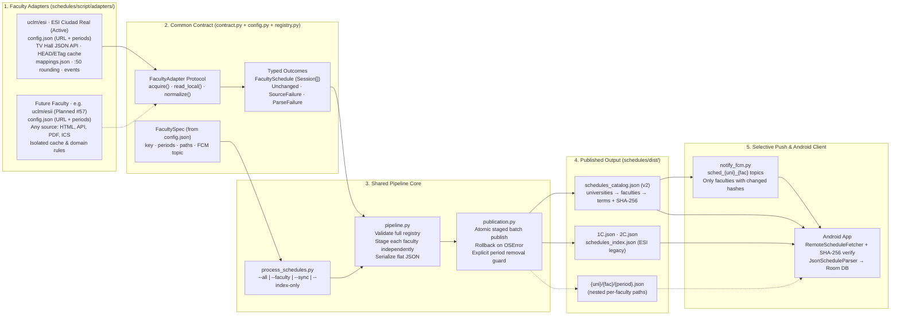
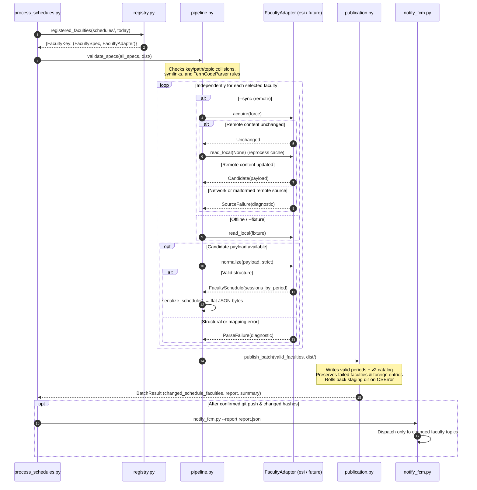
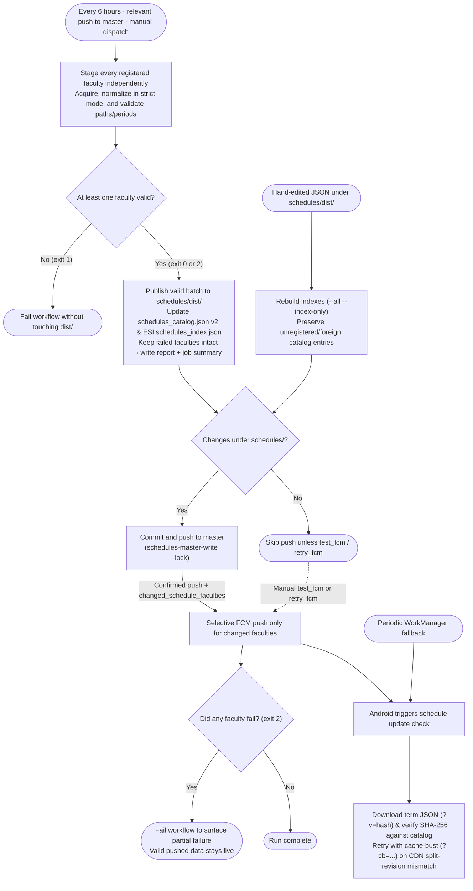
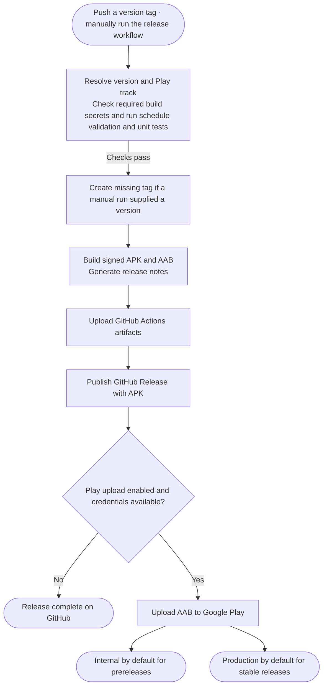

# ClemenTime Pipeline Diagrams

Visual guide to the modular multi-faculty schedule pipeline and continuous deployment workflows.

## 1. Multi-Faculty Modular Architecture

Each faculty lives in its own isolated **adapter folder** (`schedules/script/adapters/<faculty>/`) with a declarative `config.json` (identity, periods, paths, public `source_url`) and source-specific parsing. Everything downstream—registry validation, flat JSON serialization, multi-faculty catalog publishing, selective FCM, and Android import—is completely shared and faculty-agnostic.

## 2. Per-Faculty Lifecycle & How to Add a Faculty

Every registered adapter runs through the exact same three-method lifecycle. Onboarding a new faculty requires **only three touchpoints** (`adapters/<fac>/` with `config.json`, one registration line in `registry.py`, and offline fixtures/tests)—no edits to `pipeline.py`, `publication.py`, `notify_fcm.py`, CI workflows, `.env`, or Android.

## 3. Automated Sync, Partial Failure Isolation & Client Verification

[Modular schedule pipeline](modular_schedule_pipeline.md) ·
[ESI operating guide](esi_api_schedule_pipeline.md) ·
[Schedule sync workflow](../.github/workflows/sync-esi-schedules.yml) ·
[Index repair workflow](../.github/workflows/update-schedules-index.yml)

## 4. Continuous Deployment

Manual runs can choose a Play track or skip Play. The
[CI workflow](../.github/workflows/ci.yml) runs Python lint, offline `--all --strict` schedule validation, unit tests, Android Lint, Detekt, and debug APK assembly on pushes and pull requests targeting `master`. The
[release workflow](../.github/workflows/release.yml) runs its own checks before publishing.
