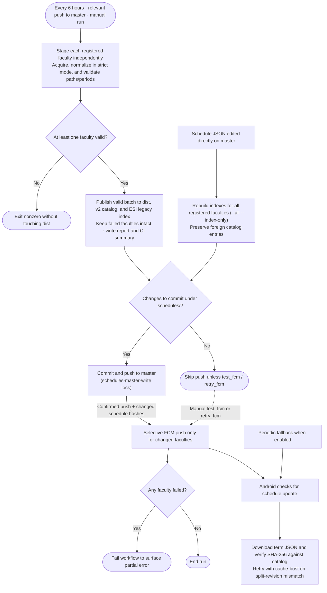

# ClemenTime pipeline diagrams

## Schedule updates

[Schedule sync workflow](../.github/workflows/sync-esi-schedules.yml) ·
[Index repair workflow](../.github/workflows/update-schedules-index.yml) ·
[Modular schedule pipeline](modular_schedule_pipeline.md)

## Continuous deployment

Manual runs can choose a Play track or skip Play. The
[CI workflow](../.github/workflows/ci.yml) runs checks on eligible pushes and
pull requests targeting `master`. The
[release workflow](../.github/workflows/release.yml) runs its own checks before publishing.
